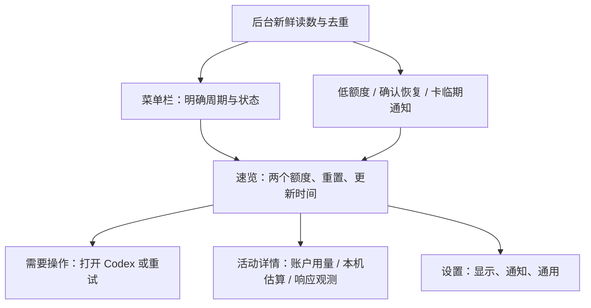

# CodexMeter 产品级深度评审与重设计建议

评审日期：2026-10-29（Asia/Shanghai）\
评审对象：当前工作区，包括已有未提交修改；本地 App 标识为 **0.4.0（19）**。这不是对已发布版本、线上行为或 Homebrew 当前状态的认证。\
交付范围：诊断、产品取舍、交互与视觉方案。本文的删除、合并、重构均为建议，本次没有实施。

## 1. 执行摘要与总体评分

**总体评分：5.6 / 10。核心需求成立，产品取舍不成立。**

CodexMeter 最有价值的事情，是让重度 Codex Desktop 用户不必切回应用查额度，并在额度不足、恢复、重置卡即将过期时得到可靠提醒。它应该减少工作中断和反复检查。

当前产品把“有数据可读”过多地等同于“应该呈现给用户”：两种额度、两种用量口径、最近响应速度、30 次响应曲线、账户历史、连续使用统计、完整设置，都进入同一个临时 Popover。实现越完整，用户越需要自己判断哪些信息值得看、来自哪里、是否仍然有效。

最需要推翻的假设是：**用户会因为看到更多 Token 和 TPS 而获得更多价值。** 这些数字没有直接回答能否继续工作，也不能自动代表效率、成果或订阅价值。产品需要明确主次，而不是继续给用户更多布局开关。

当前也存在具体的可信度缺口：今日用量的“部分估算”只在悬停帮助中出现；最近 TPS 没有醒目的时间和估算限定；额度失败原因被统一吞成泛化状态。本次新构建还出现可复现的中文资源查找失败。它们比圆角和间距更值得先解决。

**推荐方案 B：保留可靠的数据读取能力，重建默认体验。** 一个明确标注周期的菜单栏入口，一个不需滚动即可读完的额度速览，按需打开的活动详情，以及真正有价值的通知。TPS 和历史可以存在，但不再与额度争夺常驻位置。方案 C 的“异常时才需要注意我”值得做验证原型，暂不建议直接替换全部数字界面。

### 严格评分

评分含产品判断，不是用户研究结果。1–3 分表示明显阻碍目标，4–6 分表示可用但需明显改进，7–8 分表示有可靠价值，9–10 分需要成熟体验和更完整的验证。总体为下列 11 项等权均值，四舍五入。

| 维度 | 分数 | 依据与扣分理由 |
| --- | ---: | --- |
| 产品定位 | 6 | “Codex Desktop 伴侣”清楚；额度守护、速度监控、Token 统计三个方向却没有主次。 |
| 核心功能价值 | 8 | 独立查看两种额度、重置时间与提醒，确实能减少切换；尚不能证明不可替代。 |
| 功能完整性 | 6 | 读取、缓存、通知、开机启动、设置齐全；错误恢复、账户归属和本次中文构建仍有缺口。 |
| 功能克制程度 | 3 | 三个默认菜单项、五个默认详情区域、六类设置，投入与核心任务不成比例。 |
| 信息架构 | 4 | 本机今日用量下面放账户七日图；速览中混入历史、身份装饰和整套设置。 |
| 交互效率 | 5 | 查额度一次点击即可；TPS 和深入内容需滚动，设置有两种承载方式。 |
| 学习成本 | 5 | 需理解剩余额度、两个周期、TPS、估算、账户日期与本机日期、缓存星号等概念。 |
| 视觉美感 | 6.5 | 实际浅色/深色界面整洁，排版比技术 Demo 成熟；主次、密度和内容意义仍欠设计。 |
| 设计一致性 | 6 | 字体、表面和控件较统一；警告可见性、图表配色、设置导航和数据口径不统一。 |
| macOS 原生体验 | 7 | AppKit 状态项、原生控件、独立设置、快捷键和通知是实质优势；长表单 Popover 不适合当前任务。 |
| 整体产品完成度 | 5 | 可供熟悉项目的人使用；默认体验、异常处理和当前本地化验证不足以支持放心推荐。 |

## 2. 评审方法、证据边界与实际验证

### 2.1 阅读与验证范围

阅读了 README、design.md、项目规则、Package.swift、构建/测试脚本、发布配置，以及 `Sources` 中 27 个生产 Swift 文件；沿用户界面追到额度、账户统计、本机日志、TPS、缓存、通知和更新实现，并抽查相应测试。没有把“有测试”当成“实际交互已经通过”。

UI 检查依照项目规则委托给 GPT-6.1 Terra、xhigh，由同一执行者独占界面。先检查已有本地 0.4.0（19）的浅色界面，再从当前源码独立构建到临时目录，补查深色、全部区域及内嵌设置。

本文使用以下标签：

- **[实测]**：本次通过真实界面、截图或实际命令观察到。
- **[代码]**：当前源码能直接证明的结构、条件或默认值。
- **[判断]**：产品与设计取舍，可能需要用户研究修正。
- **[风险]**：存在静态证据，但未复现完整真实场景，不能当成已发生的事故。

### 2.2 真实界面观察记录

截图是在 Computer Use 工具中直接查看的真实 App 图像，**不是 SwiftUI Preview、生成图或线框图**。当前截图接口没有文档化的保存/裁剪操作，因此没有交付持久 PNG，也没有把本文的结构草图伪装为实拍。下表是可复核的文字观察记录。

| 编号 | 实际观察对象 | 可以支持的结论 |
| --- | --- | --- |
| W01 | 已有本地构建，浅色 Popover 顶部和下方 | 配额、今日统计及七日图占据主要空间，TPS 在更下方；页眉和页脚固定。 |
| W02 | 同一构建的六个设置分类 | 原生控件总体清楚；英文侧栏长标题在选中时换行，后续条目位置变化；关闭倒计时后格式/分隔符仍可操作。 |
| W03 | 今日用量出现部分估算时的截图与同状态 AX Help | AX Help 明确说明部分记录无法安全计入，数字旁无可见警告。后续数据更新会改变这一状态。 |
| W04 | 当前源码新构建，应用内深色预览，全部五个区域 | 实际文字、图表、开关可辨认；配额、今日、TPS、账户、设置均存在。不是对比度认证。 |
| W05 | 新构建的账户区域及展开的每日历史 | 累计、峰值、连续使用、最长轮次、每日记录与账户更新时间均实际出现；还有“更早日期”二级展开。 |
| W06 | 新构建展开内嵌设置 | 通用与详情布局默认展开，其他分类可展开；整套设置进一步拉长临时 Popover。 |
| W07 | 关于窗口与快捷键 | About 存在，`⌘,` 从 Popover 打开设置已验证。 |
| W08 | CodexBar 官方展示页的宣传截图 | 仅支持比较其展示的层级与密度，不能证明竞品真实交互、准确性或稳定性。 |

已有本地构建的保存布局是配额、今日、TPS 可见，账户和设置隐藏。**这不是出厂默认。** 新构建通过现有的临时预览参数展示全部五区；源码默认也确实是五区全部可见。预览没有覆盖用户持久偏好，也未改变系统外观。

未完成：原生系统菜单栏全景及刘海屏占位测量、真实 Command-drag 排序、多屏/最小屏幕、完整 VoiceOver、Increase Contrast、Reduce Motion、可靠的图表点选与键盘选点、真实断网/换账号/额度恢复、系统通知送达、Gatekeeper 首次下载体验。Popover 坐标操作和 Escape 测试遇到工具错误，**不据此认定应用不能滚动或 Escape 失效**。通过 AX 滚动实际看到了下方内容。

### 2.3 本次构建与测试结果

环境实测：Apple Silicon、macOS 27.0.1、Swift 6.4、Command Line Tools；没有完整 Xcode 验证。产品声明的 macOS 14 最低兼容性不在本次实测范围内。

- 当前源码 Release 构建、临时 App 打包和本地签名校验成功。初次在受限 shell 中启动失败，脱离该限制后成功启动并查看，故不将其列作应用打包缺陷。
- 现有 **148 项测试中 143 项通过，5 项本地化测试失败，共 9 个断言问题**。其他测试通过不代表无产品问题。
- 对新 App 内实际资源包进行独立只读查询：`en` 找到；`zh-Hans` 未找到；`zh-hans` 找到，且能返回“设置”。目录名与查找名不一致在本次环境中是实际失败，不是猜测。
- design.md 中旧的“148 项通过”属于此前记录，不能覆盖本次结果。

构建与测试使用临时输出目录，没有重写仓库内已有 App 包。本次未修改应用源码、测试、设计规范、版本、远端仓库、发布物或 Homebrew。

## 3. 产品究竟应该解决什么

### 3.1 真正的核心价值

最可信的一句话定位是：

> 在不打断工作的情况下，知道 Codex 额度还剩多少、何时重置，以及何时需要自己介入。

目标用户首先是**经常碰到额度约束、需要连续工作的 Codex Desktop 用户**。偶尔使用、不碰限额的人，并没有充分理由为此长期占用菜单栏。多供应商管理者也不是当前产品已充分覆盖的人群；不能用尚未实现的广泛支持论证现有价值。

当前没有独有、无法替代的功能。独立菜单栏读取额度已有直接竞品；本机来源筛选、保守估算和隐私边界是值得发展的差异，但它们是实现质量与信任优势，需要在使用中被感知，而不是 README 中的一段技术说明。

### 3.2 用户真正想完成的任务

| 时刻 | 用户的问题 | 应立即得到的答案 | 当前情况 |
| --- | --- | --- | --- |
| 开始一项工作前 | 额度是否已经很低？ | 两周期剩余、重置时间、数据时间 | 有原始数值；缺少集中状态表达。 |
| 工作途中 | 我是否需要分配注意力？ | 低额度或需要操作时提醒 | 通知已实现，但默认关闭，配置理解成本偏高。 |
| 额度耗尽后 | 什么时候可以再试？ | 重置倒计时，恢复需新读数确认 | 计算原则谨慎，应保留；不应靠倒计时假装已经恢复。 |
| 响应显得很慢 | 刚才那次大概有多快？ | 最近有效响应的估算值、时间与局限 | 有 TPS；显著性与时间表达不匹配。 |
| 回顾使用情况 | 最近用量如何变化？ | 明确口径的趋势 | 有图表，但被嵌在速览里且与本机统计混排。 |

“还能不能完成下一个大任务”**不能仅由剩余额度百分比可靠推出**。没有稳定的任务成本模型，就不该给出“还能写 20 个任务”或确定的剩余小时数。更好的产品可以明确说“额度充足/偏低/未知”，同时显示原始依据，不能伪装成任务完成保证。

### 3.3 如果只能保留三个能力

1. **准确可辨识的额度速览**：5 小时、7 日、剩余和重置时间，默认一个入口。
2. **可信的数据状态与恢复操作**：更新时间、暂停/缓存/失败/未知、打开 Codex 与重试。
3. **低打扰提醒**：低额度、确认恢复、可用重置卡临期，统一权限与去重逻辑。

TPS、今日 Token、七日图都排在这三项之后。这个排序是针对上述目标用户的产品判断；若后续研究证明核心用户主要在研究模型速度，则应该另做以响应观测为核心的产品，而不是让两种定位继续争抢同一首屏。

### 3.4 必须拆穿的产品假设

- Token 多不等于完成工作多。累计量、峰值和连续使用天数不应成为默认“成绩”。
- TPS 高不等于工具整体更好。这里是基于本地事件边界的有效速度估算，不是完整任务效率或严格基准。
- 账户七日曲线和本机今天估算并排，不会自然组成一个统一报表。时间、设备、来源与纳入范围都不同。
- 可自定义不等于易用。让每个人排序、隐藏五区、挑选十余种外观细节，可能是在让用户替产品完成取舍。
- 占用三个菜单栏位置不是免费的可发现性提升；它持续消耗用户最紧张的系统级空间。

## 4. 已实现功能全景与用户路径

以下盘点区分代码存在和运行验证；“未实测”不表示功能失效。

| 用户可见能力 | 当前实现与默认行为 | 证据状态 |
| --- | --- | --- |
| 菜单栏额度 | 5 小时、7 日独立 NSStatusItem，默认均开启，默认都用 AI 标签 | [代码] Display.swift、Main.swift；未截取原生菜单栏全景 |
| 菜单栏 TPS | 第三个独立状态项，默认开启，0/1 位小数、单位和上下排版可选 | [代码] Display.swift、StatusItemAppearance.swift |
| 显示样式 | 三种预设；字号、字重、字体、颜色、背景、间距、图标/自定义标签、百分号、倒计时格式与分隔符 | [代码]；[实测] 设置项存在，未穷举组合 |
| 额度详情 | 剩余百分比、进度条、相对重置时间、重置钟点、缺失与缓存状态 | [代码]；[实测] W01、W04 |
| 订阅标签 | 从账户统计中的 planType 格式化显示，不猜测未报告的倍率 | [代码]；[实测] 订阅区域 |
| 重置卡 | 可用数、最近到期摘要、展开后的状态、发放/到期时间和说明；只读，不能消费卡 | [代码]；[实测] 展开区域存在，未验证每一种服务端状态 |
| 本机今日用量 | 本地日历日，输入+输出，记录数；Desktop 及可追溯子代理，部分/回填状态 | [代码]；[实测] W03、W04 |
| 账户七日图 | 以账户最新报告日期结束，缺失日期保留空缺，可选择日期 | [代码]；[实测] 图像，点选未可靠验证 |
| 最近响应与 TPS 历史 | 最近有效样本、模型、30 个有效响应；按响应序号而非等时距离画图，模型变化断线 | [代码]；[实测] W04，交互未全测 |
| 账户统计 | 累计/峰值、当前/最长连续天数、最长轮次、全部每日记录及更早日期 | [代码]；[实测] W05 |
| 五区布局 | 排序、隐藏、恢复默认；默认全部显示，区块隐藏不停止采集 | [代码] DetailLayout.swift；[实测] 设置和新构建全部区域 |
| 手动与自动刷新 | 启动及每次点击状态项时刷新；后台额度默认 3 分钟、账户 15 分钟、本地日志 2 秒、显示 60 秒 | [代码]；[实测] 刷新入口；未测后台耗电 |
| 唤醒/联网恢复 | 合并临近事件，按查询类型限流与失败退避；关闭自动刷新后不自动校准 | [代码]；现有相关测试通过，未做真实睡眠/断网实验 |
| 通知 | 低额度阈值、恢复、卡到期；默认关闭；权限、去重及新鲜度约束 | [代码]；[实测] 配置界面，未触发权限或系统送达 |
| 设置窗口与内嵌设置 | 六类侧栏设置和 Popover 内的另一套完整设置承载；共享绑定 | [代码]；[实测] W02、W06 |
| 系统集成 | 登录启动、右键菜单、关于、`⌘,`、`⌘Q`、项目和反馈链接、退出 | [代码]；[实测] About 和 `⌘,`；未开关登录启动 |
| 中英文 | 跟随系统/English/简体中文，语言即时更新；已排程通知不重新翻译 | [代码]；本次中文资源查找失败，不能算完整验证通过 |
| 更新 | 可选自动检查、手动检查、提示新版本并打开项目，安装手动完成 | [代码]；设置存在，未安装更新 |
| 自定义数据目录与诊断 | 支持 CODEX_HOME/偏好配置与 `--diagnose`，没有图形目录选择器 | [代码] README、AppModel.swift；未改实际目录 |

### 当前主要路径

**路径一：看额度。** 看两个 AI 数字 → 通过倒计时、记忆或悬停确认周期 → 点击任意项 → 同一个详情面板。点击还会同时发起额度、账户和本机刷新，甚至右键菜单或关闭弹窗的点击也经过刷新入口。[代码：Main.swift 158–163]

**路径二：看 TPS。** 看第三个菜单项 → 点击 → 从同一个面板上部向下找“最近一次响应” → 若要时间，需要状态项 tooltip 或选择历史点。点击 TPS 并不会自动定位 TPS 区域。[代码；W01、W04]

**路径三：设置提醒。** 打开设置 → 通知 → 选择提醒、监测周期、阈值及卡到期时间 → 同时理解通知权限和自动刷新的依赖。默认不请求权限是正确的，但用户仍需拼出“我现在是否已受到保护”。[代码；W02]

**路径四：调整布局。** 进入布局页 → 用每行两个箭头逐步移动、开关隐藏 → 再打开 Popover 检查效果。用户解决的是展示拥挤，但产品把它转成了配置任务。[判断；代码]

## 5. 当前最成功的地方

这些是应该继承的资产，不是对现有整体设计的辩护。

1. **核心读取具有克制的边界。** 通过既有 Codex 子进程做只读账户查询，无需在本 App 登录；本地解析只保留白名单计数和边界，不保存会话正文。增量读取、去重和边界校验比“随便扫日志算一个数字”认真。[代码：AppServer、LogMonitor、LocalActivity、TPSParser]
2. **未知通常没有伪装成零。** 未报告日期留空、不跨缺口连线、无可靠计时不制造 TPS、倒计时过去不擅自恢复额度。这些数据原则应成为下一版的不可退让项。[代码；相关测试]
3. **基础视觉已经有统一语言。** 系统字体、等宽数字、平面分区、语义背景和细分隔线，在真实浅色/深色界面中清楚。没有必要为了“高级”改成玻璃卡片墙。[实测；MeterStyle.swift]
4. **真正采用了 macOS 能力。** 原生状态项、设置窗口、标准 About、系统通知与登录服务、快捷键，比套一个浏览器仪表盘合适。[代码；W02、W07]
5. **提醒具备成为核心价值的条件。** 新鲜读数、恢复迟滞、去重和卡到期排程已存在，可以从“很多开关中的一个分类”提升为明确的守护能力。[代码；通知集成测试]

这些优势主要在底层可靠性。问题是它们没有同样清晰地转化成用户可以一眼理解的产品。

## 6. 最严重的十个产品问题

优先级定义：P0 为需立即停止交付的已证实重大损害，本次未发现足够证据；P1 为下一轮开发首先处理；P2 为随结构重设计完成。排序综合影响、证据强度与触发频率，静态风险不伪装成已发生故障。

### 01. 速览缺乏唯一主任务，Popover 变成了小型全功能窗口

- **证据**：[实测] W01、W04–W06；[代码] [PopoverView.swift:16](/Volumes/case-sensitive/personal-project/CodexMeter/Sources/CodexMeterApp/PopoverView.swift:16) 在一个 ScrollView 中依次装五区；[DetailLayout.swift:33](/Volumes/case-sensitive/personal-project/CodexMeter/Sources/CodexMeterCore/DetailLayout.swift:33) 默认无隐藏；[Main.swift:239](/Volumes/case-sensitive/personal-project/CodexMeter/Sources/CodexMeterApp/Main.swift:239) 最高 740 pt，宽固定 420 pt。
- **为什么是问题**：[判断] 瞬时查询、趋势回顾和长期配置有不同的注意力要求，却被要求共享一个会随外部点击消失的容器。
- **用户影响**：查 TPS 需要越过额度和账户图；展开历史或设置后，面板更长。即使能隐藏区块，也只是用户自行整理。
- **替代方案**：Popover 只放两个额度、时间/状态和有条件的提醒摘要，常规内容不滚动；活动详情与设置分别按需进入独立窗口。移除每次打开都重复的标语，订阅降为普通辅助文字。
- **优先级 / 范围**：P1；需要重新设计信息架构。减小字体不是解决方案。

### 02. 部分估算被呈现得像完整总量

- **证据**：[实测] W03，且新构建深色界面再次出现；[PopoverView.swift:231](/Volumes/case-sensitive/personal-project/CodexMeter/Sources/CodexMeterApp/PopoverView.swift:231) 只把 `isPartial` 放入 help，数字区域没有可见“部分估算”。[LocalActivity.swift:205](/Volumes/case-sensitive/personal-project/CodexMeter/Sources/CodexMeterCore/LocalActivity.swift:205) 确有多种造成部分统计的条件。
- **为什么是问题**：完整性属于数值含义，必须跟数值同时可见。悬停帮助不是数值完整性的合适容器。
- **用户影响**：可能把不完整本机记录当作完整今日消耗，对比账户数值时进一步困惑。
- **替代方案**：数字旁常显“本机估算”；部分状态显示“统计不完整”及图标，详情再解释原因。不要擅自标成数学上的“至少”，除非已证明所有误差方向都只会少算。
- **优先级 / 范围**：P1；可局部修复，并纳入统一数据状态设计。

### 03. TPS 的显著性超过证据强度，且旧样本缺少醒目的时间语境

- **证据**：[Display.swift:226](/Volumes/case-sensitive/personal-project/CodexMeter/Sources/CodexMeterCore/Display.swift:226) 无论样本年龄都输出数值；[PopoverView.swift:160](/Volumes/case-sensitive/personal-project/CodexMeter/Sources/CodexMeterApp/PopoverView.swift:160) 的主值没有时间或估算标签；`latestUnmeasurable` 仅说明“最近请求不可测”，不是年龄判断。完成时间藏在状态项 tooltip 和历史选点里。[代码；W04]
- **为什么是问题**：[判断] 常驻 TPS 很像当前吞吐，但它实际上是某次已完成响应的估算；模型、响应长度与等待阶段都可能不同。
- **用户影响**：空闲或后续不可测时，旧数值仍有权威外观，可能被用来判断“现在快不快”或比较模型。
- **替代方案**：默认从菜单栏移走；活动详情写“上次有效响应 · 12 分钟前 · 估算”，显示模型、输出量、有效耗时。若用户主动常驻 TPS，空闲显示“上次”语义或降显，不必删除历史值。
- **优先级 / 范围**：P1；需重新定义 TPS 的产品角色，时间限定可先局部修复。

### 04. 缓存、暂停、失败与可恢复操作没有组成完整体验

- **证据**：[AppModel.swift:224](/Volumes/case-sensitive/personal-project/CodexMeter/Sources/CodexMeterApp/AppModel.swift:224) 把所有额度错误统一成一条消息，未保留缺安装、未登录、超时、协议不支持等分类；这些分类原本存在于 [AppServer.swift:5](/Volumes/case-sensitive/personal-project/CodexMeter/Sources/CodexMeterCore/AppServer.swift:5)。[PopoverView.swift:79](/Volumes/case-sensitive/personal-project/CodexMeter/Sources/CodexMeterApp/PopoverView.swift:79) 的“Live quota / 实时额度”只看来源和标记，没有年龄上限。
- **为什么是问题**：[代码] 关闭自动刷新后，最后成功读数不会仅因变老而从 Live 降级。[判断] 时间戳虽在底部，状态文案仍在暗示当前有效。无数据的额度区域显示等待，具体登录提示又在刷新按钮的 help 中。
- **用户影响**：不知道是等待、未安装、退出登录还是兼容性失败；重复点刷新可能没有帮助。长时间暂停后容易误读旧额度。
- **替代方案**：顶部明确显示“刚更新 / 3 分钟前 / 已暂停 / 连接失败 / 尚无数据”；失败保留旧读数但说明原因，提供“打开 Codex”“重试”“查看诊断”。不要把成功轮询称为持续实时连接。按预期刷新周期和延迟预算定义年龄状态。
- **优先级 / 范围**：P1；需要设计数据状态和恢复流程。[风险] 本次未通过真实断网复现所有分支，不能声称发生了全部失败场景。

### 05. 本机今天与账户七日被放成一个视觉整体，容易产生错误归属

- **证据**：[实测] W01、W04：今日之后直接出现截至前一天的账户七日图；[PopoverView.swift:229](/Volumes/case-sensitive/personal-project/CodexMeter/Sources/CodexMeterApp/PopoverView.swift:229) 的 localTodaySection 包含 account TokenUsageChart。[TokenUsageSeries.swift:20](/Volumes/case-sensitive/personal-project/CodexMeter/Sources/CodexMeterCore/TokenUsageSeries.swift:20) 用最新报告日期结束七日范围；延迟说明主要在 help 中。
- **为什么是问题**：标题虽写“账户”，父区域却是“今日·本机”；两种来源、时间边界和覆盖范围并不相同。源数据没有被相加是正确的，视觉分组仍可能暗示可直接对照。
- **用户影响**：难以解释为什么今天有数但曲线没有今天、为什么不同设备和子代理会有口径差异。
- **替代方案**：账户历史独立为“账户用量 · 数据截至 10/28”，本机内容明确为“这台 Mac · 今日估算”；两者不得共享一个含混的父标题，无法确认服务端时区时直接说明。
- **优先级 / 范围**：P1；需要重组内容，日期标签可先局部补充。

### 06. 默认三个菜单项，其中两个都叫 AI，既占空间又不自解释

- **证据**：[Display.swift:83](/Volumes/case-sensitive/personal-project/CodexMeter/Sources/CodexMeterCore/Display.swift:83) 默认同时显示三项；[Display.swift:193](/Volumes/case-sensitive/personal-project/CodexMeter/Sources/CodexMeterCore/Display.swift:193) 两个额度默认前缀都是 AI；[Main.swift:115](/Volumes/case-sensitive/personal-project/CodexMeter/Sources/CodexMeterApp/Main.swift:115) 创建三个独立状态项。README 也明确要求悬停辨认周期。
- **为什么是问题**：[判断] 用户需要记住位置或看悬停说明才知道哪个百分比是什么。两个截止时间也不总能自然消除歧义，例如两个周期都接近重置时。
- **用户影响**：高频扫描需要额外解释，占位随倒计时和数字变化；刘海屏挤出风险有理由验证，但本次没有测量，不能声称已挤出。
- **替代方案**：默认一个入口，文字直接含周期，如“5h 32%”；展开同时看两周期。允许用户固定周期或主动启用分离显示。自动选择若按最低剩余百分比，必须称为该策略，不能等同于“最先耗尽”。
- **优先级 / 范围**：P1；默认产品形态需要重新设计。A 方案至少把 AI 改为 5h / 7d。

### 07. 本次构建的中文功能存在实质性资源加载失败

- **证据**：[实测] 5 项现有本地化测试失败；新 App 包目录是 `zh-hans.lproj`。独立 Foundation 查询结果为 `zh-Hans missing`、`zh-hans found`，后者能读取中文。[Localization.swift:46](/Volumes/case-sensitive/personal-project/CodexMeter/Sources/CodexMeterCore/Localization.swift:46) 按 `zh-Hans` 请求 lproj。
- **为什么是问题**：支持语言是产品承诺，资源存在不等于运行时能找到。当前失败影响设置、帮助和通知文字，不能用“设计稿已考虑中文”替代验收。
- **用户影响**：中文用户在这条构建路径下会得到英文回退，体验与已提供的选项不符。
- **替代方案**：后续修复资源解析/打包兼容性，以打包后的 App 和项目实际工具链验证语言切换及新通知文本；保留真实构建包烟测。
- **优先级 / 范围**：P1，中文交付前必须解决；局部功能修复。本次不修改。此结论限当前环境/产物，未断言每一份历史发行包都有同样问题。

### 08. 缓存和通知按目录隔离，却没有已验证的账户归属闭环

- **证据**：[AppModel.swift:103](/Volumes/case-sensitive/personal-project/CodexMeter/Sources/CodexMeterApp/AppModel.swift:103) 用标准化 CODEX_HOME 路径散列隔离额度、账户缓存和提醒；[AccountInfo.swift:33](/Volumes/case-sensitive/personal-project/CodexMeter/Sources/CodexMeterCore/AccountInfo.swift:33) 不保留账户身份；额度快照也没有账户身份。两个查询分别更新。
- **为什么是问题**：[风险] 同一路径切换账户、且查询部分失败时，旧统计或提醒状态缺少明确的归属校验。保护隐私是正确的，但“完全不建归属”与“无需显示邮箱”不是同一个问题。
- **用户影响**：可能把旧账户缓存看作新账户数据，或者在新账户沿用旧的提醒基线；**本次未实际切换账户，不能声称已发生串号或数据泄露。**
- **替代方案**：先核实只读协议能否提供稳定、可隐私处理的账户作用域；可以使用本地不可逆标识而不展示邮箱。如果身份不可验证，应主动标明缓存归属未确认、限制复用并重建提醒基线。无需因此扩张成多账号管理器。
- **优先级 / 范围**：P1 风险验证；需数据生命周期和身份状态设计，不是单纯换一个标题。

### 09. 设置把呈现细节暴露为长期维护任务

- **证据**：[实测] W02、W06；[SettingsView.swift:192](/Volumes/case-sensitive/personal-project/CodexMeter/Sources/CodexMeterApp/SettingsView.swift:192) 以后有字体、背景、间距、标签、分隔符、小数、布局等细项；四个刷新周期各自可配。关闭倒计时没有禁用其依赖项；英文侧栏选择时换行跳动实测存在。
- **为什么是问题**：[判断] 设置分类按实现对象拆分，“外观”和“标签与可见指标”让用户为同一个菜单栏效果在两页间切换；完整配置又可在 Popover 重复展开。
- **用户影响**：需要学习很多无业务意义的细节；设置过程本身比使用核心功能更复杂，且缺少实时整体预览。
- **替代方案**：普通设置只保留显示内容、通知、登录启动和语言；技术刷新周期收进高级，常规改成“标准/省电”且说明监测时效；整合菜单栏显示配置并给局部预览。关闭父选项时禁用/隐藏子选项；固定侧栏行高。取消内嵌完整表单。
- **优先级 / 范围**：P2；部分可局部修复，整体需重新设计。不要把所有旧选项换个标签继续堆进“高级”。

### 10. 账户统计没有经过价值筛选，容易把消耗包装成成绩

- **证据**：[实测] W05；[PopoverView.swift:196](/Volumes/case-sensitive/personal-project/CodexMeter/Sources/CodexMeterApp/PopoverView.swift:196) 突出 lifetime、peak、current/longest streak 和 longest turn。这里没有与任务结果或额度变化的可靠映射。
- **为什么是问题**：[判断] “用得久、用得多”不是该工具的目标。尤其最长轮次既可能代表复杂工作，也可能代表等待与低效率，单值没有明确可行动含义。
- **用户影响**：首屏和注意力被低频数字占用，也可能诱导把资源消耗当价值。没有用户研究证明所有用户都不需要历史；应削弱的是默认突出程度和无依据的成功暗示。
- **替代方案**：删除连续天数、最长轮次的常规产品展示；累计/峰值降为历史详情，保留清楚口径的近期趋势。用户主动研究时再提供原始信息，不做勋章、排行榜或“多消耗更优秀”的激励。
- **优先级 / 范围**：P2；需要产品删减决策，代码难度相对低。

## 7. 交互与视觉：应该换什么，而不只是润色什么

### 7.1 信息应如何分层

| 层级 | 应放什么 | 不应继续承担什么 |
| --- | --- | --- |
| 菜单栏：一瞥 | 明确周期的关键剩余或状态、异常标记 | 两个无差别 AI 标签、默认常驻旧 TPS、长时间字符串的堆叠 |
| Popover：几秒 | 两种额度、重置、更新时间、暂停/失败、必要的卡临期提示 | 完整图表探索、历史长列表、整套设置 |
| 活动详情：主动探索 | 账户历史、本机估算、响应观测，各自标明口径和时间 | 把不同来源混成一个“总用量” |
| 设置：低频配置 | 通知、启动、显示与高级兼容性 | 反复补救默认布局、让用户管理四个计时器 |

菜单栏低额度状态、数据过期/暂停、未登录、卡临期应主动可见。累计 Token、完整卡说明、30 次 TPS、日历史及诊断可进入二级界面。过期状态不能只靠色彩或星号表达。

### 7.2 视觉方向判断

当前不是典型的“渐变 + 毛玻璃 + 卡片墙”模板，批评它有严重 AI 模板感并不符合截图。实际问题更接近**用统一组件平铺所有数据**：每区都有标题、符号、大数字、分隔线，却缺少一个足够强的注意力优先级。

界面已有克制的表面和系统字体，值得保留。28 pt 主数字用于额度和本机 Token 等多个指标时，多个重要性不同的对象获得近似权重。订阅皇冠、产品名与整句标语反复占据速览顶部；它们在官网有用，在每次打开的小工具里收益很低。这是视觉资源分配错误，不是圆角不够精致。

设置的原生 Form 和侧栏比自制网页设置正确。但原生外观不是原生任务体验的充分条件：完整配置塞入临时 Popover，仍然是一种不适配容器的交互。

### 7.3 专业团队应采用的设计语言

建议方向是**安静、可判断的系统仪表**，而不是开发者成绩面板。

- 用一个稳定的工具身份和清楚的周期标签建立识别，不依赖皇冠或品牌标语。
- 两种额度是视觉主角。普通状态用中性色与系统强调色；低额度、未知和过期状态配文字/符号。不要把所有缺失都染成危险红。
- 以原生列表行和有意义的分隔组织内容；卡片只在确有分组边界时使用，不给每个数包一个容器。
- 数字、单位、重置时间按相同列对齐；主文字保持原生可读字号。11 pt 可以用于辅助说明，不能承担关键可信度条件。
- 图表中的“按日期累计”优先试验离散柱形；响应样本优先散点或短条。当前折线并非数据计算错误，但容易暗示连续变化和可比较过程。[判断]
- 账户图目前硬编码蓝色、TPS 用系统 accent。后续按“额度状态/历史/响应估算”建立明确语义，而不是无意混用。[代码：TokenUsageChart.swift 37–39、TPSHistoryChart.swift 30]
- 不新增连续动画、呼吸灯或反复变化的颜色；数字变化稳定排版。不要为了表现“实时”制造注意力负担。

UI/UX Pro Max 被用于反馈、状态与 SwiftUI 可访问性检查。其整产品检索及一次收窄重试仍返回网页 Hero/CTA 和 Web 字体，**不适合本 App，未作为方案依据**；不把移动端 44 px 目标尺寸机械套给 macOS 菜单。最终方向由任务、平台和真实截图决定。

### 7.4 具体替代交互

| 当前痛点 | 明确替代交互 | 成功标准 |
| --- | --- | --- |
| 点击任一指标都打开同一长面板 | 默认单入口打开速览；若保留分离 TPS，点击直达响应详情 | 不滚动即可完成对应入口的主要任务 |
| 每次菜单点击、右键甚至关闭也刷新所有来源 | 展示已有数据；打开时按年龄选择刷新，手动刷新明确触发；关闭/右键不做无关查询 | 不产生与用户意图无关的重复查询；实测延迟/能耗后定阈值 |
| 首次无数据时只显示等待和刷新 | 按原因显示“打开 Codex 并登录”“未找到安装”“暂时连接失败”；一个主要操作 | 新用户不必阅读 README 即可恢复 |
| 通知开关与自动刷新关系需自己理解 | 显示“后台监测：开启/暂停，系统通知：允许/未允许”；启用提醒时解释并提供启用监测的动作 | 用户能说清现在是否会收到提醒 |
| 关闭倒计时后仍能调分隔符 | 子控件禁用或收起；保留原选择用于再次开启 | 不再出现看似有效却无可见作用的设置 |
| 调外观后反复打开菜单检查 | 在“菜单栏显示”页提供真实尺寸的局部预览 | 不切换窗口即可评估结果 |
| 自定义目录只能 defaults 命令 | 高级页提供只读检测结果与用户主动目录选择；默认自动发现 | 非默认用户无需终端；不把路径塞入普通首屏 |

## 8. 竞品与行业标杆

调研于 2026-10-29 读取官方公开页面、官方仓库/文档；没有安装竞品，没有验证其性能、付费转化、留存或准确性。只对实际拿到的证据下结论，不以星数代替设计质量。

| 对象与证据 | 已确认的做法 | 对 CodexMeter 的启发 | 不宜照搬 |
| --- | --- | --- | --- |
| [CodexBar 官方仓库](https://github.com/steipete/CodexBar)与[UI 文档](https://github.com/steipete/CodexBar/blob/main/docs/ui.md) | 官方说明支持额度/重置查询，并提供合并状态项和切换入口 | 聚合入口是可行的空间策略；先明确服务与数据时间 | 它面向多供应商，不能据此要求本产品扩张到同样范围 |
| [CodexBar 官方展示页](https://codexbar.app/)；W08 宣传图 | 展示把更新时间、额度和重置置于紧凑顶部，并展示节奏提示 | 学习“先帮助判断，再给更多数据”的层级 | 宣传中的节奏/用尽预测没有在本次核实算法，不能复制为确定承诺；其密度也可能偏高 |
| [iStat Menus 官方页面](https://bjango.com/mac/istatmenus/) | 官方提供可配置监控、事件规则和合并模式，明确以节省菜单栏空间为用途 | 让常驻信息与详细菜单各有职责，合并不必等于丢功能 | 通用系统监控需要多模块，不代表单一额度工具也该展示所有可读字段 |
| [Stats 官方仓库](https://github.com/exelban/stats) | 明确聚焦系统监控，列出模块，也说明 Command-drag 的系统排序方式 | 目标和模块边界要明确，优先沿用系统行为 | 模块多本身不是优势；这次未实测其 UI，不给视觉优劣排名 |
| [Apple WWDC：What's new in SwiftUI](https://developer.apple.com/videos/play/wwdc2022/10052/) | 官方展示纯菜单栏应用、独立辅助窗口和 macOS grouped forms | 菜单栏小工具与独立详情/设置并存有平台基础 | 不要求为了“更原生”而重写现有 AppKit 状态项 |

Apple HIG 的部分页面本次只能读到需 JavaScript 的壳或 Markdown 获取错误，故不伪称逐条完成最新版 HIG 合规认证。本文的密度、取舍与字号建议是本产品的设计判断，有可读官方资料的地方才作来源引用。

当前产品自己的机会是：**为 Codex Desktop 做得更专注、更透明、更少配置**。不是通过供应商数量胜出，也不是以“大 Token 数字”复制另一个统计工具。现有保守解析、低权限要求和本机优先策略适合这条路线；长期是否成立仍需真实用户验证。

## 9. 功能取舍：删除、保留、合并、新增

下表以推荐方案 B 为基准；“删除展示”不等于本次删除数据或代码。

| 决策 | 功能 | 理由与边界 |
| --- | --- | --- |
| 保留并突出 | 两周期额度、重置、新鲜度与手动重试 | 直接支持工作判断，是产品存在理由 |
| 保留并提升 | 低额度/确认恢复/卡临期提醒 | 能减少检查次数，须明确监测和权限状态 |
| 保留但条件显示 | 重置卡可用数与临期摘要 | 有实际可用/临期信息时出现；未知不能写成零，明细二级 |
| 保留为按需详情 | 本机今日估算、账户近期趋势 | 部分用户有回顾需要，必须分清来源、日期与完整性 |
| 保留为可选观测 | 最近 TPS 与短历史 | 对研究响应速度的人有用，默认退出菜单栏，不称基准测试 |
| 删除常规展示 | 连续使用天数、最长轮次 | 缺少可行动价值，容易把消耗与使用频率当成果 |
| 降级 | 累计和峰值 Token | 从速览降至历史详情；若无人使用，后续再删除 |
| 删除重复容器 | Popover 内完整设置 | 独立设置足以完成任务，重复表单拉长面板 |
| 取消默认复杂度 | 三个状态项、五区任意布局与大量外观微调 | 首先用合理默认设计解决；分离状态项可作为明确的高级选择 |
| 合并 | 外观 + 标签 + 可见指标 | 都在回答“菜单栏显示什么、怎么看”，应有统一预览 |
| 合并 | 刷新控制 + 通知运行状态 | 用户关心监测是否有效；技术周期收进高级 |
| 新增 | 可见的数据可信度状态、分类错误与恢复动作 | 是当前信任缺口，不是另添统计 |
| 新增 | 隐私友好的账户归属校验 | 防止缓存跨身份误用，先验证协议能力 |
| 新增 | 首次打开的连接状态说明 | 一个小状态页即可，不做多页引导教程 |
| 暂缓 | 用尽预测、模型排名、订阅回本金额 | 当前数据不足以支撑稳健结论，容易制造假精确 |
| 不扩张 | 多供应商、团队报表、云同步、自动消费重置卡 | 偏离当前目标，增加凭证、服务和维护面；没有足够需求证据 |

## 10. 三种方向不同的重设计方案

以下是结构草图，不是已实施的界面，也不是本次真实截图。

### 方案 A：保守优化——整理现有监控工具

**定位**：继续提供额度、Token、TPS 的综合监控，保留主要功能与现有分离状态项能力。

- 菜单栏默认标签至少改成 `5h`、`7d`，TPS 明确是上次响应；给分离/紧凑显示一个清楚选择。
- Popover 顶部固定配额和数据状态；“活动”展开后才加载视图中的今日、账户历史与响应观测，所有原有统计仍可访问。
- 账户图从本机今日区域移走；完整设置入口统一到原生窗口。
- 不再固定用满 740 pt；常规面板随内容收敛，只有用户主动展开才滚动。
- 保留大部分配置，但去掉失效依赖、修复导航跳动，并提供预览。

```text
菜单栏： [5h 32%] [7d 61%] [上次 73 TPS]

CodexMeter                         刷新
额度 · 1 分钟前更新
5 小时       剩余 32%       14:20 重置
7 日         剩余 61%       周二重置
重置卡摘要（有意义时）
───────────────────────────────────
▸ 活动：今日 / 账户趋势 / 最近响应
设置…
```

**优点**：迁移风险较小，现有熟练用户损失少；可以很快修复数据语义。\
**缺点**：仍是多指标监控器，三项常驻和过量配置的价值问题没有根除。把统计折叠起来只是缓解。\
**估计**：1–2 周；前提是一名熟悉项目的工程师加少量设计支持，不含公证发布与完整多系统验收。

### 方案 B：大幅重构——额度速览 + 按需活动详情（推荐）

**定位**：帮助 Codex Desktop 重度用户管理注意力和额度中断。额度是主产品，统计是可选附件。

**菜单栏**：默认一个项目，固定的工具符号加明确周期和值。用户可以固定 5h/7d；若提供自动策略，明确其选择规则并保持当前周期标签。严重状态显示可读标记，不用漂移的颜色代替解释。TPS 仅经主动选择才常驻。

**Popover**：约 340–380 pt 宽、常规约 300–420 pt 高的设计起点，最终由真实内容和屏幕验证决定；无需为达成数字强行缩字。首屏回答额度、重置、是否新鲜、是否需要操作。

```text
Codex                            1 分钟前更新
5 小时额度                        剩余 32%
[─────────                       ]
14:20 重置 · 约 2 小时后

7 日额度                          剩余 61%
[───────────────────             ]
11 月 3 日重置

重置卡 1 张 · 明日到期             查看
后台监测已开启
────────────────────────────────────────
活动详情…                        设置…
```

上图所有数字都是说明结构的假设示例，不是账户读数；两周期都是权威读数的呈现，不生成“还能完成多少工作”的承诺。

**活动详情窗口**：只在用户主动请求时打开，采用简洁的“用量 / 响应”两页；用量页将“账户数据，截至某日”和“本机今日估算”分组，默认不给累计/连续使用颁发视觉奖励。响应页显示样本年龄、模型、估算值和原始分母信息。需求不足时宁可做一个简单详情页，不先建分析工作台。

**设置**：通用、菜单栏显示、通知；高级作为披露区域，而不是第四套庞大系统。自动刷新默认可用，技术周期一般由产品决定；提醒保持主动启用，不在首次启动强弹权限。关闭监测时明确列出对提醒的影响。

**视觉**：保留现有 SF 字体、语义背景和原生控件，重做层级及排布，不发明一套装饰皮肤。去皇冠、速览标语、重复信息行与无意义图标。

**优点**：用户价值最集中，同时保留合理的观测需求；数据基础可以复用，不必重写日志与协议。\
**缺点**：需要偏好迁移和说明；原有 TPS 爱好者可能不接受默认降级，要提供明确选择。独立详情也增加一种窗口，需用实际使用需求约束规模。\
**估计**：2–4 周；包含状态模型、界面、偏好迁移和针对性验证，不是只画一张新皮肤。

### 方案 C：颠覆性重设计——异常驱动的额度守护器

**重新定义**：用户长期安装它，是为了少想额度，而不是为了观看指标。把产品从“仪表盘”变为“只有需要你时才出现的提醒工具”。

**最小功能集**：两周期额度读取；低额度/重置后确认恢复/卡临期提醒；数据连接和暂停状态。取消本机 Token 账本、账户历史、TPS、连续使用、布局编辑和外观工坊的常规产品功能。

**形态**：一个小菜单栏入口始终保留可达性；正常状态安静，异常状态附短标签。默认速览以状态说明为主，精确数字在展开后可查。系统通知承载重要变化，不做浮层常驻、不接管用户任务、不自动消费卡。

```text
常态： [工具符号]
异常： [工具符号 额度偏低]    或    [工具符号 数据过期]

5 小时额度偏低
最近确认剩余 8% · 1 分钟前
约 38 分钟后重置；恢复后再通知我

▸ 查看两个周期的准确读数
打开 Codex                         设置…
```

“额度偏低”以明确阈值解释，不称“危险”或“无法完成任务”。数据过期和额度低必须是不同状态。到点不直接宣布恢复，保持当前“新读数确认”的原则。

**彻底放弃**：用统计数量证明价值、每次打开看曲线、为了显得活跃而常驻 TPS、让用户设计自己的 Popover、完整设置内嵌。

**优点**：注意力成本最低，产品承诺最清晰；最终 UI 和维护表面最小。\
**缺点**：主动想看数字的人会觉得信息被隐藏；通知被 Focus 抑制、权限拒绝或后台读数失败时，价值会下降。是否真能减少检查焦虑尚无用户证据。\
**估计**：约 3–4 周完成可验证原型及小范围试用；不保证一个月就能证实留存优势。无需先重写整个底层。

### 三方案对比

价值、易用性、视觉潜力为评审预估，10 分更好；复杂度、成本与维护负担为相对判断，不能冒充已测结果。

| 比较项 | A：综合监控整理 | B：额度主导，按需详情 | C：异常驱动守护 |
| --- | --- | --- | --- |
| 核心用户价值 | 6.5：现有价值更易读 | 8：直接围绕额度决策 | 8.5 潜力：减少反复检查，尚需验证 |
| 易用性 | 6.5：功能仍多 | 8：速览与探索分开 | 8：简单，但依赖状态/通知被理解 |
| 视觉品质潜力 | 7：整理既有语言 | 8.5：稳定的主次关系 | 8：精度取决于状态表达，不靠装饰 |
| 产品复杂度 | 高，保留多数选项 | 中，合理保留详情 | 低，但异常状态逻辑仍需认真做 |
| 实施成本 | 低至中，约 1–2 周 | 中，约 2–4 周 | 中，约 3–4 周含研究 |
| 长期维护 | 仍高：组合和重复界面多 | 中：主要三种界面职责明确 | UI 较低，数据兼容性维护依然存在 |
| 用户迁移风险 | 低 | 中，需要解释默认变化 | 高，会放弃部分现有受众 |
| 主要失败方式 | 整洁但依旧没有取舍 | 把详情窗口又做成大仪表盘 | 为求安静而藏掉关键状态，通知失效时价值不足 |

**推荐 B 的理由**：它解决已观察到的结构问题，同时不要求立即相信“大家都只想被通知”这个尚未验证的假设。A 保留了过多原始问题；C 值得试验，但其受众取舍大于当前证据能够支持的范围。

## 11. 最推荐的未来产品形态与验收原则

未来应当是一个**单一入口、可信状态、按需深入的 Codex 额度工具**。



不建议全面重写 Swift 架构。需要重做的是默认产品结构、状态表达和展示取舍；解析器、只读协议和去重能力应沿用经过验证的部分。

后续验收不能只看“像不像专业软件”，应要求：

1. 新用户在 5 秒内说对两周期剩余及数据是否新鲜；以小规模任务测试验证，不能只由作者判断。
2. 常规打开不滚动即可完成额度查询；详情和设置不进入主任务路径。
3. 部分、过期、暂停、未知、失败与真实零值，在不悬停、不辨颜色时也能区分。
4. 用户能解释通知是否有效；拒绝权限与关闭监测均有明确恢复动作。
5. 中文、浅深色、键盘、VoiceOver、典型小屏和多屏分别有实际记录；不能用渲染单测代替。
6. 账户变化或无法确认归属时，不把旧缓存当作已验证的当前账户数据。
7. 不把 Token 消耗推算为成果、金额、任务数，或把响应 TPS 包装为模型排名。

## 12. 优先级明确的改进路线图

这里只规划，不执行。时间是假设一名熟悉项目的工程师与可及时评审的设计支持，下一阶段再估工。

| 阶段 | 工作与优先级 | 明确产出和通过条件 |
| --- | --- | --- |
| 第 1 阶段：先修可信度 | P1：中文资源、可见部分估算、TPS 时间/估算、暂停与年龄状态 | 当前打包产物中文验证成功；上述关键条件无需 hover 就能理解；现有失败测试复查 |
| 同期：验证身份边界 | P1：同 CODEX_HOME 切账号、部分查询失败、缓存与提醒作用域 | 明确复现结果；有稳定身份则隔离，没有则清楚降级，不带假设交付 |
| 第 2 阶段：B 方案原型 | P1：单入口、非滚动速览、独立活动详情、单一设置入口 | 可点击原型/本地原型，让 5–7 位目标用户完成额度、恢复与提醒任务；这是研究计划，不是已经访谈 |
| 第 3 阶段：结构实现 | P1/P2：内容分层、来源拆分、删低价值展示、设置整合 | 保留必要旧偏好迁移；原始数据语义不变；入口有明确去向 |
| 第 4 阶段：产品交付质量 | P1/P2：键盘与 VoiceOver、小屏多屏、耗电/刷新延迟、首次安装与更新说明 | 有对应实测记录和可复查指标；签名/公证若计划公开分发，再独立授权与验收 |
| 后续实验 | C：安静默认与异常标签，对比 B 的长期体验 | 观察是否减少反复打开、是否漏掉重要状态；无证据不删除所有详情 |

建议衡量的是：查额度任务正确率、误认旧数据比例、异常后的恢复成功率、每次决策耗时、通知重复/误报、用户是否仍需回 Codex 核对。不要把打开次数、Token 总量和通知数量增加当作成功。

### 如果只能再投入两周

第一周先完成可信度问题和身份边界验证；第二周做 B 的菜单栏与速览最小切片，取消默认长内容与重复设置承载，实测额度查读和提醒启用。暂停新增曲线、统计和外观选项。若资源加载和状态问题耗时超预期，宁可不赶完整详情窗口。

### 如果可以重新设计一个月

最值得推翻的是“三个默认菜单项 + 五区长 Popover + 六类微配置”的组合。复用数据能力，完成 B 的新默认、明确的活动详情、设置收敛、身份/缓存生命周期和实际无障碍验证。最后用小范围试用判断 C 的安静模式，不把整月投入另一轮表面美化。

### 最值得立即实施的五项改变

1. **恢复可信的数据限定**：今日数字旁显示估算/不完整；TPS 显示上次时间和估算；额度把暂停、年龄、失败说清楚。
2. **解决本次中文资源加载失败**：按打包后产物验收，不引用旧测试结果。
3. **把默认菜单栏收为一个明确周期的入口**：A 路线至少先修 5h/7d 标签；不再默认三项常驻。
4. **把速览缩成真正的速览**：两额度、重置、更新时间、必要卡提示；内嵌完整设置与长历史退出主界面。
5. **把本机与账户口径拆开**：图表常显数据截止日，删去连续使用和最长轮次的常规展示。

前两项主要修复信任，后三项实现产品取舍。账户归属验证应并行进行，发现实际复现风险时优先于后续视觉实现。

## 13. 反向产品审查：如果这是别人开发的软件

### 我会愿意长期安装吗？

**以当前默认体验，我不会直接推荐长期安装。** 我会在自己经常遇到 Codex 限额时试用，把菜单栏收为一项、隐藏大部分区块，再观察是否足够可靠。需要先自行“整理一遍”才能愿意留下，说明默认产品还没有完成。

会让我留下的，是无需新的登录、查看额度迅速、重要状态提醒可靠、可解释的缓存与来源。会让我卸载的，是菜单栏被三个数字占据、旧 TPS 看起来像当前速度、用量不完整却没有显著提示，或者每次看到异常仍要回原 App 确认。

### 哪些地方显得不够专业？

不是缺少渐变或动画，而是完整性条件藏在 tooltip、两类来源挂在一个今日区域、设置选中后行高变化、中文选项与本次构建结果不一致，以及把长期配置塞进临时面板。它们说明产品规则还没有和显示规则一起设计。

### 哪些功能根本不该占据这里？

连续使用天数、最长轮次和整套内嵌设置不该占据额度速览。完整历史、累计 Token 和 TPS 曲线可以放在主动探索里，但不应拿来证明这个菜单栏工具功能丰富。继续增加装饰预设和分隔符也不是当前值得做的事。

### 缺什么才值得推荐？

一个无需配置的好默认、一眼可辨的时间与可信度、可恢复的异常、有效而不吵的提醒，以及实际打包产物在目标系统/语言/辅助技术上的证据。面向普通用户公开分发时，当前文档明确的 ad-hoc 签名与手动安装更新也应成为正式交付体验的改进对象；本次没有做下载首启测试，不把它写成已复现的阻止安装。

## 14. 如果这是我自己的产品，我会如何重新做？

我会先做一款**让人少检查额度的工具**，只服务容易被额度中断的 Codex Desktop 用户。产品承诺是“状态清楚，需要你时提醒”，不承诺衡量生产力。

第一版只有一个菜单栏入口、两种额度、重置与数据时间、三类必要提醒、一个很短的设置页。数据失败时优先告诉用户该做什么，成功时退到背景。未知就写未知，部分就写部分，缓存就写上次读数。

我不会做账户使用勋章，不会放皇冠，不会默认展示 Token 累计和 TPS，不会开放五区任意编排，也不会让用户管理四个刷新周期。字体和间距由产品决定，少数真实的可读性选择保留；不会用十几个外观旋钮代替设计决定。

我会保留精确读数的可达性，避免把“安静”变成“不透明”。后台恢复不依赖倒计时猜测；通知被拒绝或监测暂停，菜单栏仍清楚显示状态。

只有当真实用户反复提出“我要回顾用量”时，才增加独立活动详情；只有发现一批用户真的依赖响应观测时，才增加可选 TPS。两者的存在要由使用任务证明，不能由底层 API 恰好返回这些字段来决定。

这会比当前版本少很多展示内容，但每个保留下来的元素都有明确职责。现有代码中最值得留下的是谨慎的读取和统计基础；最值得放弃的是把所有基础能力一次性摆到用户面前的冲动。

---

评审到此结束。推荐选择方案 B，再以小范围试验验证方案 C 的安静默认。本次只新增本评审文档，未实施任何应用变更、提交或发布。
