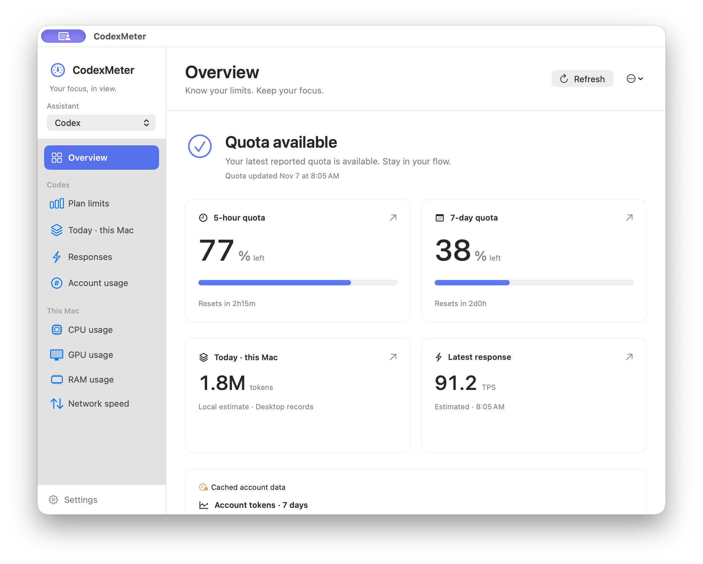

# CodexMeter

**Codex, Cursor and DeepSeek Harness in one quiet, native Mac workspace.**

For Codex, choose independent menu bar indicators for quota, local tokens, response speed and system metrics. Click an indicator for details, or open the resizable workspace to explore limits, usage and system metrics. Usage combines this Mac's daily estimate and account history in one page, with their dates and totals kept distinct. Cached readings, paused refresh and unavailable data have their own visible states.

Choose your assistant in the quick overview or workspace sidebar. Codex keeps its plan-window and local-activity views. Cursor reads the signed-in account's reported weekly or billing-cycle allowance. DeepSeek Harness reads local session checkpoints, with cumulative tokens and observed model timing; these are separate from daily usage and account billing. Missing or incompatible data stays unavailable.

Built with Swift, SwiftUI and AppKit. No Electron, separate API key or third-party runtime dependencies.

[Install](#install) · [What the numbers mean](#what-the-numbers-mean) · [Privacy](#privacy-and-data-flow) · [Detailed guide](docs/usage.md) · [Report an issue](https://github.com/spider-man-peter-park/CodexMeter/issues)

<p>
  
</p>

*Earlier workspace layout, captured in an actual macOS window with sample data and no image retouching. [DeepSeek Harness in dark Chinese](docs/images/codexmeter-workspace-deepseek-dark.png) shows the same workspace with a different source.*

## Menu bar and workspace

- **Independent Codex metrics:** choose visible items, labels and styles in Settings. Existing display choices are preserved, including when upgrading from the removed Focus mode.
- **One workspace and Settings window:** a persistent sidebar contains plan limits, Usage, responses, hardware and all Settings categories. Command-comma returns to the last settings category; Command-0 opens Overview. Menu bar clicks keep opening independent detail popovers while this window is visible. Usage retains separate dates and totals for local activity and account history.
- **Projected HUD:** an animated white/gold mechanical reactor snaps to the screen edge and remembers its position. Hover to build a centered cyan instrument projection with the playground's reversible beam, traced rings and surrounding telemetry panels. A black blurred backdrop dims that display. The dashboard shows the selected assistant's metrics plus CPU, GPU, RAM and upload/download; its surfaces, light and backdrop pass desktop clicks through. Left-click the orb for an energy pulse, hold to drag, and right-click for options. Hide it from the context menu, app menu checkbox or Settings → General → Show floating HUD.
- **Additional assistants:** Cursor and DeepSeek Harness each use one source indicator and a compact overview with a workspace action.

Hardware sampling follows visible system menu bar items, open system pages and the expanded HUD. Process details are requested only while their matching system page is open.

## At a glance

| Metric | Example | What it shows |
| --- | --- | --- |
| 5-hour quota | `82% · 2h14m` | Remaining quota and time until reset, when reported by your account |
| 7-day quota | `61% · 4d8h` | Remaining weekly quota and reset countdown |
| Today's local tokens | `tok 69.2M` | Estimated input + output tokens recorded on this Mac today |
| Latest response | `TPS 73` | Estimated effective output tokens per second for a completed response |
| CPU / GPU | `CPU 27%` / `GPU 9%` | Local processor utilization; unavailable GPU telemetry shows a dash |
| RAM | `RAM 50%` | Physical memory used by apps, wired memory and compression |
| Upload / download | `↑ 1.5 KB/s` above `↓ 2.3 MB/s` | Both transfer rates share one native menu bar item |

*Illustrative values, not live readings.* Hide the independent Codex items you do not need, and hold Command to drag items into place. Accounts that report only weekly quota do not keep an unsupported 5-hour card after a successful read.

- **More detail when you need it.** Each menu bar item opens its matching detail. RAM includes pressure, a two-minute history, memory composition, swap and top processes; CPU includes core usage, load averages and top processes; GPU includes supported driver readings and hardware information. Network details include the top processes with separate upload/download rates. Account token history, recent-response TPS charts and reset credits remain available.
- **Local reminders.** Low-quota, quota-recovery and reset-credit expiry alerts, with configurable thresholds and macOS notification permission.
- **Your menu bar, your layout.** Choose labels, typography, colors and inline or stacked TPS. CPU/GPU/RAM each have independent icon and label switches, with the label above or left of its number. Switch between enabled modules through the other-details menu.
- **Native macOS behavior.** Light and dark appearance, launch at login, English and Simplified Chinese. Runs in the menu bar without a Dock icon; open the workspace when needed.

Each menu bar item uses a compact fixed width for its selected font, labels and layout. Changing readings, network units, countdowns or cache state does not move neighboring items. Stacked RAM aligns its label with the numeric digits, excluding `%`. Today's tokens adds an optional `tok` label between its icon and count. Detail popovers fit their expanded content up to the screen height; workspace pages scroll within the window.

## Install

### Requirements

- **macOS 14 Sonoma or later.**
- **The assistant you want to monitor.** Codex and Cursor use their app's existing sign-in. DeepSeek Harness needs readable local session checkpoints. You can use Cursor or DeepSeek Harness without Codex installed.
- **Apple Silicon** for the prebuilt ZIP and Homebrew cask. On Intel, build from source.

CodexMeter looks for Codex in registered applications and standard installation paths, including supported ChatGPT.app integrations, then falls back to `codex` in `PATH`. Available account fields depend on your installed Codex version and account.

### Homebrew

```bash
brew tap spider-man-peter-park/codexmeter https://github.com/spider-man-peter-park/CodexMeter
brew install --cask spider-man-peter-park/codexmeter/codexmeter
open -a CodexMeter
```

This is the project's third-party tap, not the official Homebrew Cask repository. The cask checks a SHA-256 against a version-specific archive at an immutable commit.

### Download the app

[Download for Apple Silicon](https://github.com/spider-man-peter-park/CodexMeter/raw/refs/heads/main/dist/CodexMeter-macOS-arm64.zip), unzip it, move `CodexMeter.app` into `/Applications`, then open it.

> **Signing:** The distributed app is ad-hoc signed, not Apple-notarized. Homebrew keeps standard quarantine behavior. If macOS blocks it, build from source or use the normal **System Settings → Privacy & Security → Open Anyway** flow only if you trust this repository. CodexMeter does not require Accessibility, Screen Recording or network-interception permissions.

### First launch

1. Look for CodexMeter's metric indicators in the menu bar.
2. Click one for details, or open the workspace from its context menu to choose your assistant.
3. Open **Settings** to choose visible metrics, refresh intervals and language. New installations request launch at login once; you can disable it in Settings.
4. To receive reminders, enable notifications in Settings and grant macOS permission. Keep Automatic Refresh enabled for background monitoring.

For Homebrew updates, run `brew update` followed by `brew upgrade --cask spider-man-peter-park/codexmeter/codexmeter`. In-app update checks are optional and off by default; they announce updates but do not install them.

## What the numbers mean

**Quota is not a token budget.** The quota percentages and reset windows come from Codex's account response, not a conversion from local token counts. A passed countdown does not prove quota has replenished; CodexMeter waits for a fresh reading. Cached or stale quota is identified in hover help and details; unavailable data is not treated as zero.

**Today's tokens are a local estimate.** They cover identifiable Desktop sessions and traceable subagents in this Mac's available logs, using the Mac's local day. Input includes cached input; output includes reasoning output, so neither subtotal is added twice. This is not a guaranteed account-wide total, billing figure or measure of remaining quota. Server-reported account statistics are shown separately and may lag.

**TPS is effective response speed, not a benchmark.** It divides a completed response's output tokens by its measurable elapsed time. Waiting, buffering and other timing effects can influence it. It is not streaming decode speed or task-wide throughput. Unsupported or incomplete timing produces no new sample, not a fabricated number. Desktop samples are preferred; unattributed fallback samples carry a warning and may include CLI activity.

**System metrics describe this Mac.** CPU is total busy time across all cores between samples. GPU uses macOS driver telemetry and shows the busiest reporting GPU on multi-GPU Macs; unsupported telemetry remains unavailable. RAM counts app, wired and physically compressed memory, excluding reclaimable cache. Network speeds use decimal bytes per second (1 KB = 1,000 bytes), summed across active Wi-Fi/Ethernet interfaces; loopback and virtual interfaces are excluded to avoid double counting. These are transfer rates, not an internet speed test. Local metrics refresh every two seconds independently of Codex account refresh, pause during sleep and need a new baseline after wake. Each menu bar item can be hidden separately, and CPU, GPU, RAM and Network have configurable detail sections.

See the [data-source reference](docs/usage.md#data-and-refresh-behavior) and [TPS limitations](docs/usage.md#effective-tps-and-accuracy) for exact scope and parsing behavior.

## Privacy and data flow

- **Codex account queries:** CodexMeter starts the installed Codex App Server and requests account, quota and usage information. The Codex subprocess uses your existing sign-in and makes its normal service requests. CodexMeter does not read Codex authentication tokens, submit prompts, start coding tasks or consume reset credits.
- **Cursor account queries:** Selecting Cursor reads its existing local sign-in through a read-only SQLite connection, then requests usage from `https://cursor.com`. The session is held only for the request, never saved or printed. Protected credentials use standard macOS Keychain access without raising a permission dialog; denied access is shown explicitly. Codex quota windows and Cursor allowance periods are kept separate.
- **DeepSeek Harness:** Only local projection caches are read. Forked or inherited sessions are excluded from cumulative totals to avoid double counting, and incomplete coverage is marked. No Harness credentials, balance endpoint, inference or price estimate is used.
- **Local logs:** Token and TPS estimates are derived from local Codex session files. CodexMeter retains derived counters and parsing checkpoints, not prompt or response text. It does not upload conversations, usage counters or project paths.
- **System metrics:** CPU, GPU, memory and network counters are read locally through macOS APIs. Hardware readings stay in memory; no network traffic contents are inspected.
- **Optional update checks:** Manual checks, or automatic checks if enabled, fetch public version metadata from GitHub. There is no telemetry, proxy, cloud sync or separate CodexMeter service.

Live account readings require the selected service's connection. No assistant conversations, local usage counters or project paths are uploaded by CodexMeter. See [storage and privacy details](docs/usage.md#incremental-files-and-privacy), including custom `CODEX_HOME` support.

## Build from source

On a Mac with Xcode 16+ or the Swift 6 Command Line Tools:

```bash
git clone https://github.com/spider-man-peter-park/CodexMeter.git
cd CodexMeter
./scripts/test.sh
./scripts/build-app.sh
open build/CodexMeter.app
```

The build uses the host architecture and signs the app ad hoc. No third-party package downloads are required. You can also open `CodexMeter.xcodeproj`; see [build details](docs/usage.md#build-and-test) for Xcode and restricted-environment options.

## Help and contribute

- [Usage, notifications and troubleshooting](docs/usage.md)
- [Diagnostics](docs/usage.md#diagnostics) · [Uninstall](docs/usage.md#uninstall)
- [Interface design notes](design.md)
- [Bug reports and feature requests](https://github.com/spider-man-peter-park/CodexMeter/issues)

For a bug report, include your macOS, Codex and CodexMeter versions, what you expected, and what happened. Review diagnostics and screenshots before sharing: they can reveal your usage metrics. Do not include authentication files or conversation logs. For code changes, run `./scripts/test.sh` and describe the behavior covered.

## License and affiliation

The code is [MIT licensed](LICENSE). Optional OpenAI logo assets are OpenAI trademarks and are excluded from that license; see [asset sources](Sources/CodexMeterApp/Resources/ASSET-SOURCES.md). The response-boundary approach was researched against [adenta/codex-tps](https://github.com/adenta/codex-tps); see [references](docs/usage.md#references-and-license).

CodexMeter is an independent project, not an OpenAI product.
