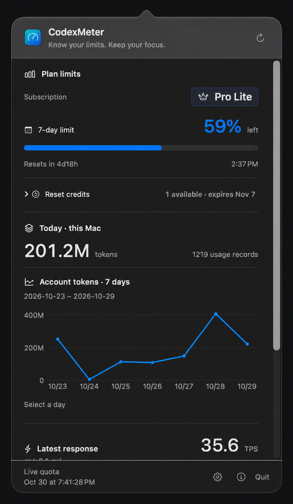

# CodexMeter

**Codex quota, token usage and response speed in your Mac menu bar.**

Keep your remaining Codex quota and reset countdowns in sight while you work. Click a menu bar item to see plan limits, today's local token usage and recent response-speed estimates, without switching back to Codex.

Built with Swift, SwiftUI and AppKit. No Electron, separate API key or third-party runtime dependencies.

[Install](#install) · [What the numbers mean](#what-the-numbers-mean) · [Privacy](#privacy-and-data-flow) · [Detailed guide](docs/usage.md) · [Report an issue](https://github.com/spider-man-peter-park/CodexMeter/issues)

<p>
  
</p>
<p>
  
</p>

*Captured example readings, not live data. The detail-panel image has an AI-cleaned background for presentation and is not an unedited screenshot; the menu bar image is the original capture.*

## At a glance

| Metric | Example | What it shows |
| --- | --- | --- |
| 5-hour quota | `82% · 2h14m` | Remaining quota and time until reset, when reported by your account |
| 7-day quota | `61% · 4d8h` | Remaining weekly quota and reset countdown |
| Today's local tokens | `69.2M` | Estimated input + output tokens recorded on this Mac today |
| Latest response | `TPS 73` | Estimated effective output tokens per second for a completed response |

*Illustrative values, not live readings.* Each metric is an independent native menu bar item: hide what you do not need, and hold Command to drag items into place. Accounts that report only weekly quota do not keep an extra unsupported 5-hour item visible after a successful read.

- **More detail when you need it.** Account token history, a recent-response TPS chart and remaining reset credits, when available from Codex.
- **Local reminders.** Low-quota, quota-recovery and reset-credit expiry alerts, with configurable thresholds and macOS notification permission.
- **Your menu bar, your layout.** Choose labels, typography, colors and inline or stacked TPS; reorder or hide detail sections.
- **Native macOS behavior.** Light and dark appearance, launch at login, English and Simplified Chinese. No Dock icon or main window.

## Install

### Requirements

- **macOS 14 Sonoma or later.**
- **An installed, signed-in Codex Desktop.** CodexMeter uses its existing account through the installed Codex executable; it does not provide a separate sign-in flow.
- **Apple Silicon** for the prebuilt ZIP and Homebrew cask. On Intel, build from source.

CodexMeter looks for Codex in registered applications and standard installation paths, including supported ChatGPT.app integrations, then falls back to `codex` in `PATH`. Available account fields depend on your installed Codex version and account.

### Homebrew

```bash
brew tap spider-man-peter-park/codexmeter https://github.com/spider-man-peter-park/CodexMeter
brew install --cask spider-man-peter-park/codexmeter/codexmeter
open -a CodexMeter
```

This is the project's third-party tap, not the official Homebrew Cask repository. The cask checks a SHA-256 against a version-specific archive at an immutable commit.

### Download the app

[Download for Apple Silicon](https://github.com/spider-man-peter-park/CodexMeter/raw/refs/heads/main/dist/CodexMeter-macOS-arm64.zip), unzip it, move `CodexMeter.app` into `/Applications`, then open it.

> **Signing:** The distributed app is ad-hoc signed, not Apple-notarized. Homebrew keeps standard quarantine behavior. If macOS blocks it, build from source or use the normal **System Settings → Privacy & Security → Open Anyway** flow only if you trust this repository. CodexMeter does not require Accessibility, Screen Recording or network-interception permissions.

### First launch

1. Look for CodexMeter's items in the menu bar, not the Dock.
2. Click any item to open details and refresh the readings.
3. Open **Settings** to choose visible metrics, refresh intervals and language. New installations request launch at login once; you can disable it in Settings.
4. To receive reminders, enable notifications in Settings and grant macOS permission. Keep Automatic Refresh enabled for background monitoring.

For Homebrew updates, run `brew update` followed by `brew upgrade --cask spider-man-peter-park/codexmeter/codexmeter`. In-app update checks are optional and off by default; they announce updates but do not install them.

## What the numbers mean

**Quota is not a token budget.** The quota percentages and reset windows come from Codex's account response, not a conversion from local token counts. A passed countdown does not prove quota has replenished; CodexMeter waits for a fresh reading. `*` marks cached or stale quota, and unavailable data is not treated as zero.

**Today's tokens are a local estimate.** They cover identifiable Desktop sessions and traceable subagents in this Mac's available logs, using the Mac's local day. Input includes cached input; output includes reasoning output, so neither subtotal is added twice. This is not a guaranteed account-wide total, billing figure or measure of remaining quota. Server-reported account statistics are shown separately and may lag.

**TPS is effective response speed, not a benchmark.** It divides a completed response's output tokens by its measurable elapsed time. Waiting, buffering and other timing effects can influence it. It is not streaming decode speed or task-wide throughput. Unsupported or incomplete timing produces no new sample, not a fabricated number. Desktop samples are preferred; unattributed fallback samples carry a warning and may include CLI activity.

See the [data-source reference](docs/usage.md#data-and-refresh-behavior) and [TPS limitations](docs/usage.md#effective-tps-and-accuracy) for exact scope and parsing behavior.

## Privacy and data flow

- **Account queries:** CodexMeter starts the installed Codex App Server and requests account, quota and usage information. The Codex subprocess uses your existing sign-in and makes its normal service requests. CodexMeter does not read or store authentication tokens, submit prompts, start coding tasks or consume reset credits.
- **Local logs:** Token and TPS estimates are derived from local Codex session files. CodexMeter retains derived counters and parsing checkpoints, not prompt or response text. It does not upload conversations, usage counters or project paths.
- **Optional update checks:** Manual checks, or automatic checks if enabled, fetch public version metadata from GitHub. There is no telemetry, proxy, cloud sync or separate CodexMeter service.

This is not an entirely offline app: live account readings require Codex's service connection. See [storage and privacy details](docs/usage.md#incremental-files-and-privacy), including custom `CODEX_HOME` support.

## Build from source

On a Mac with Xcode 16+ or the Swift 6 Command Line Tools:

```bash
git clone https://github.com/spider-man-peter-park/CodexMeter.git
cd CodexMeter
./scripts/test.sh
./scripts/build-app.sh
open build/CodexMeter.app
```

The build uses the host architecture and signs the app ad hoc. No third-party package downloads are required. You can also open `CodexMeter.xcodeproj`; see [build details](docs/usage.md#build-and-test) for Xcode and restricted-environment options.

## Help and contribute

- [Usage, notifications and troubleshooting](docs/usage.md)
- [Diagnostics](docs/usage.md#diagnostics) · [Uninstall](docs/usage.md#uninstall)
- [Interface design notes](design.md)
- [Bug reports and feature requests](https://github.com/spider-man-peter-park/CodexMeter/issues)

For a bug report, include your macOS, Codex and CodexMeter versions, what you expected, and what happened. Review diagnostics and screenshots before sharing: they can reveal your usage metrics. Do not include authentication files or conversation logs. For code changes, run `./scripts/test.sh` and describe the behavior covered.

## License and affiliation

The code is [MIT licensed](LICENSE). Optional OpenAI logo assets are OpenAI trademarks and are excluded from that license; see [asset sources](Sources/CodexMeterApp/Resources/ASSET-SOURCES.md). The response-boundary approach was researched against [adenta/codex-tps](https://github.com/adenta/codex-tps); see [references](docs/usage.md#references-and-license).

CodexMeter is an independent project, not an OpenAI product.
